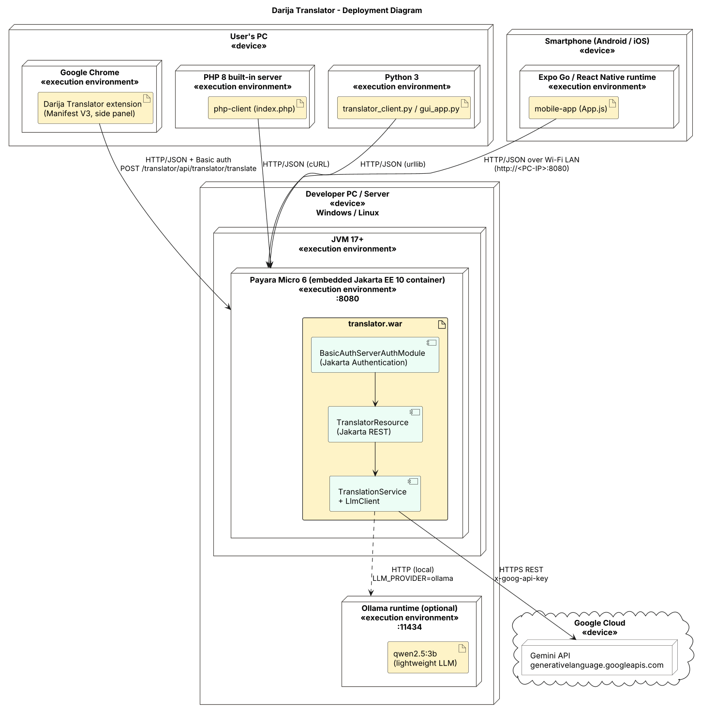

# Darija Translator — LLM-powered RESTful Web Service

Mini Project 2 · Haitham Qranfal (122683) · Al Akhawayn University

A Java **Jakarta REST** web service that translates English / French / any language into **Moroccan Arabic (Darija)** using a Large Language Model (Google **Gemini**, free tier, or a lightweight local model through **Ollama**). The endpoint is secured with **HTTP Basic authentication implemented as a Jakarta Authentication `ServerAuthModule`**, and is used by four clients:

| Client | Folder | Highlights |
|---|---|---|
| Chrome extension (Manifest V3) | `chrome-extension/` | `chrome.sidePanel`, right-click menu, selected text auto-pasted, voice-to-voice, read aloud, history |
| PHP web app | `php-client/` | cURL + Basic auth, web form and CLI |
| Python app | `python-client/` | standard library only, CLI + Tkinter GUI, optional TTS |
| React Native mobile app | `mobile-app/` | Expo SDK 58, read aloud (expo-speech), copy, history, settings |



---

## 1. REST API

Base URL: `http://localhost:8080/translator/api`

| Method | Path | Auth | Description |
|---|---|---|---|
| `GET` | `/health` | public | Service status, LLM provider and model |
| `POST` | `/translator/translate` | Basic | **`translate()`**: JSON `{"text": "...", "sourceLanguage": "auto"}` → `TranslationResponse` |
| `POST` | `/translator/translate` | Basic | `text/plain` body → plain Darija text |
| `GET` | `/translator/translate?text=...&source=English` | Basic | Same business method, query-string form |
| `GET` | `/translator/whoami` | Basic | The principal authenticated by the Jakarta Authentication module |

Example response:

```json
{
  "original": "How are you today?",
  "translation": "كي داير اليوم؟",
  "transliteration": "kidayr lyoum?",
  "sourceLanguage": "English",
  "targetLanguage": "Moroccan Arabic (Darija)",
  "provider": "gemini",
  "model": "gemini-flash-latest",
  "cached": false,
  "durationMs": 1240
}
```

Errors are JSON: `400` empty/too-long text, `401` missing/wrong credentials, `429` LLM quota exhausted, `502` LLM unreachable.

Demo accounts (stored as salted SHA-256 hashes in `server/src/main/resources/users.properties`):
`haitham / darija2026` and `demo / demo123`.

---

## 2. Run the server

**Requirements:** JDK 17+ (tested up to JDK 25) and Maven 3.9+ (internet access the first time, to download Payara Micro).

```bash
cd server
# Windows (PowerShell):  $env:GEMINI_API_KEY="your-key"
export GEMINI_API_KEY="your-key"          # free key: https://aistudio.google.com/apikey
mvn clean package payara-micro:start
```

The WAR runs on **Payara Micro 6**, an embedded Jakarta EE 10 container, at `http://localhost:8080/translator`. You can also run `run-server.bat` or `run-server.sh`.

**Alternatives:**

* Run it manually: `java -jar payara-micro-6.2025.11.jar --deploy target/translator.war --port 8080`
* Deploy `target/translator.war` to GlassFish 7 or Payara Server 6 from IntelliJ (context root `/translator`).

### Configuration (environment variables)

| Variable | Default | Meaning |
|---|---|---|
| `LLM_PROVIDER` | `gemini` | `gemini`, `ollama` (local lightweight LLM) or `mock` (offline demo) |
| `GEMINI_API_KEY` | – | Google AI Studio key (never commit it) |
| `GEMINI_MODEL` | `gemini-flash-latest` | Any Gemini model id, e.g. `gemini-3.6-flash` (use a pinned model if `-latest` answers 503 "high demand") |
| `OLLAMA_URL` / `OLLAMA_MODEL` | `http://localhost:11434` / `qwen2.5:3b` | Local LLM (`ollama pull qwen2.5:3b`) |
| `TRANSLATOR_USERS` | – | Extra users, e.g. `alice:pass1,bob:pass2` |
| `CACHE_SIZE`, `MAX_TEXT_LENGTH`, `LLM_TIMEOUT_SECONDS` | 500, 5000, 60 | Tuning |

New password hash: `java -cp target/classes ma.aui.translator.security.PasswordHasher <password>`

### Test with cURL / Postman

```bash
curl -u haitham:darija2026 -H "Content-Type: application/json" \
     -d '{"text":"How are you today?"}' \
     http://localhost:8080/translator/api/translator/translate
```

* `docs/curl-tests.sh` (bash) and `docs/curl-tests.ps1` (Windows) run the full test list, including the 401 and 400 cases. The PowerShell script checks each status code and exits 1 on failure.
* Import `docs/postman/DarijaTranslator.postman_collection.json` into Postman: 9 requests with test assertions.

---

## 3. Security: Jakarta Authentication

* `security/BasicAuthServerAuthModule` implements `jakarta.security.auth.message.module.ServerAuthModule`. Its `validateRequest()` decodes `Authorization: Basic …`, checks the credentials against `CredentialStore`, and hands the caller and its group (`translator`) to the container through `CallerPrincipalCallback` and `GroupPrincipalCallback`. When the credentials are missing or wrong it answers `401` with `WWW-Authenticate: Basic realm="DarijaTranslator"`.
* `security/AuthModuleRegistrar` (`@WebListener`) installs the module with the Jakarta Authentication 3.0 API `AuthConfigFactory.getFactory().registerServerAuthModule(module, servletContext)`.
* `WEB-INF/web.xml` protects `/api/translator/*` (role `translator`). `/api/health` and CORS pre-flight `OPTIONS` requests stay public. `glassfish-web.xml` maps the group to the role.
* Passwords are stored as salted, iterated SHA-256 hashes and compared in constant time.

---

## 4. Clients

### Chrome extension (`chrome-extension/`)

1. Open `chrome://extensions`, turn on **Developer mode**, click **Load unpacked** and pick the `chrome-extension` folder.
2. Select text on any page, then **right-click → Translate "…" to Darija** (or press **Ctrl+Shift+Y**). The side panel opens, the text is pasted automatically and translated.
3. With **Auto-paste** on, any text you select while the panel is open is pasted into it straight away.
4. 🎤 **voice-to-voice**: speak, and the speech is turned into text, translated, and read aloud. The first time, a tab opens to grant microphone access.
5. 🔊 **Read aloud** uses an Arabic voice when one is installed, otherwise it reads the Arabizi with a French voice. 📋 copies the result. History keeps the last 20 translations.
6. ⚙ sets the server URL, username and password, and has a **Test connection** button.

### PHP (`php-client/`)

```bash
cd php-client
php -S localhost:8000          # open http://localhost:8000
php cli.php "Where is the train station?"
```

Settings live in `config.php`, or in the env vars `TRANSLATOR_URL`, `TRANSLATOR_USER` and `TRANSLATOR_PASSWORD`. The PHP `curl` extension must be enabled.

### Python (`python-client/`)

```bash
cd python-client
python translator_client.py "I love Moroccan food"
python translator_client.py -i                 # interactive
python gui_app.py                              # Tkinter desktop app (pip install pyttsx3 for read-aloud)
```

### React Native (`mobile-app/`)

```bash
cd mobile-app
npm install
npx expo start          # scan the QR code with Expo Go (SDK 58)
```

In ⚙ set the server URL to your PC's LAN IP, e.g. `http://192.168.1.20:8080/translator`. The phone and the PC must be on the same Wi-Fi, and Windows Firewall must allow port 8080. For the Android emulator use `http://10.0.2.2:8080/translator`.

---

## 5. Architecture (UML)

Sources are in `docs/uml/*.puml` (PlantUML), rendered to PNG and SVG.

* Class diagram: `docs/uml/class-diagram.png`
* Deployment diagram: `docs/uml/deployment-diagram.png`
* Sequence diagram (translate from the extension): `docs/uml/sequence-diagram.png`
* Use case diagram: `docs/uml/use-case-diagram.png`

Design notes:

* **Strategy pattern**: `LlmClient` with `GeminiClient`, `OllamaClient` and `MockLlmClient`. A CDI producer (`LlmClientFactory`) picks one from `LLM_PROVIDER`, so the resource never depends on a specific vendor.
* **Prompt design**: the system prompt asks for authentic Darija (not MSA) and for a JSON answer. The user text is fenced between `<<<TEXT … TEXT>>>` markers so instructions hidden in the text are not obeyed. Gemini is called with `responseMimeType: application/json`.
* **LRU cache** (`TranslationCache`) saves free-tier quota on repeated phrases.

## 6. Project structure

```
server/            Maven WAR (Jakarta EE 10): api, service, llm, security, config
chrome-extension/  Manifest V3 extension (side panel, context menu, content script)
php-client/        PHP 8 web + CLI client
python-client/     Python 3 CLI + Tkinter GUI
mobile-app/        Expo / React Native app
docs/              UML, Postman collection, cURL scripts, demo script, blog post
```
